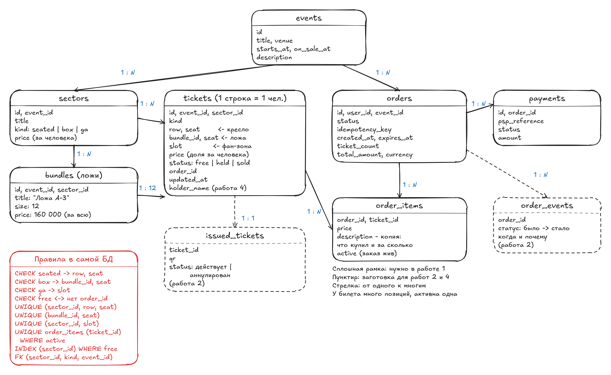
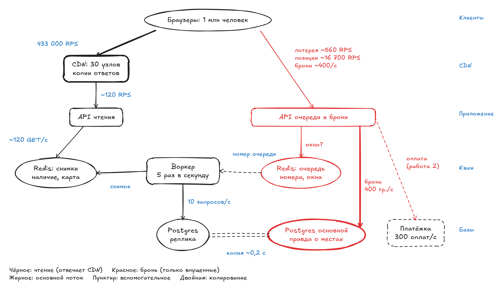
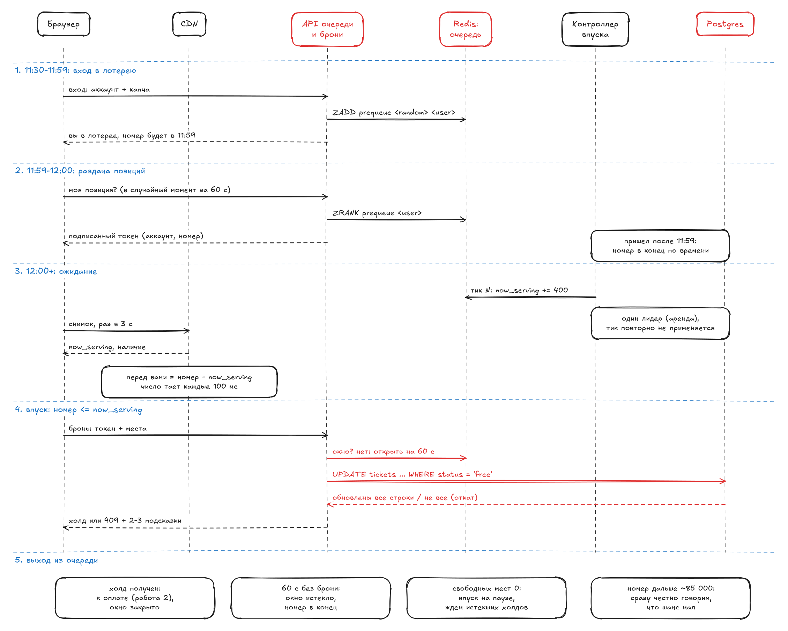

# Работа 1. Путь чтения: страница события

**Вопрос работы.** На странице есть описание, которое не меняется месяцами, и счетчик мест, который устаревает за секунду. Как это кэшировать (основной вопрос)? Что такое единица инвентаря (1.1)? Что видит человек в 12:00:00 (1.2)?

**Ответ коротко.**
- Каждый кусок страницы кэшируется со своим сроком. Толпу обслуживает CDN, до нас доходит ~120 RPS.
- Одна строка `tickets` = один человек. Ложа = 12 строк + запись в `bundles`. Правила записаны в БД.
- Страница видна всем. Очередь стоит только перед бронью, впуск 400 чел./с - по пропускной способности платежной системы.

## 1. Допущения

**Спрос**
- Д1. На старте продаж 1 млн человек.
- Д2. В заказе в среднем 2,5 билета.
- Д3. 75 % резервов доходят до оплаты.

**Зал**
- Д4. Два концерта по 80 000 мест. Каждый: 40 секторов * 1 150 мест, фан-зона 33 280, 60 лож * 12.

**Платежка и БД**
- Д5. Платежная система принимает 300 оплат/с. Это лимит по договору с провайдером: у [Stripe](https://docs.stripe.com/rate-limits) по умолчанию 100 запросов/с на аккаунт, для распродаж лимит поднимают по запросу.
- Д6. Транзакция брони длится 4 мс.
- Д7. Реплика БД отстает на 0,2 с.

**Инфраструктура**
- Д8. У CDN 30 узлов, наш сервер отвечает за 50 мс.
- Д9. Браузер опрашивает счетчики раз в 3 с, карту зала раз в 10 с.
- Д10. Размеры (оценка, без замеров):
  - снимок наличия 2 КБ: ~42 сектора * ~50 Б JSON,
  - карта зала: 1 бит на кресло или место в ложе, фан-зоны на карте нет, в gzip в среднем 4 КБ (в худшем случае, когда места вперемешку, без сжатия),
  - строка билета 200 Б: строка ~105 Б + индексы ~90 Б,
  - копия в заказе 500 Б: описание ~200 Б в UTF-8 + поля и индекс, с запасом,
  - запись очереди 100 Б: элемент sorted set в Redis.
- Д11. Лотерея идет с 11:30 до 11:59, позиции раздаются за 60 с.
- Д12. Человек, которому ответили "зайдите позже", повторяет попытку раз в 10 с.
- Д13. В 12:00 без предрегистрации приходят еще 300 000 человек за 10 с.

## 2. Расчеты

**Продажи**
- Р1. Билетов: 2 * 80 000 (Д4) = **160 000**.
- Р2. Заказов: 160 000 (Р1) / 2,5 (Д2) = **64 000**.
- Р3. Впуск: 300 (Д5) / 0,75 (Д3) = **400 чел./с**. Если впускать больше, платежка не успеет.
- Р4. Все места в холде: 160 000 (Р1) / (400 (Р3) * 2,5 (Д2)) = **160 с**. Оплатить все заказы быстрее платежки нельзя: 64 000 (Р2) / 300 (Д5) = **213 с**. Места кончаются раньше денег: после 160-й секунды впуск ждет, пока истекут неоплаченные холды (их 25 %, Д3).
- Р5. Нужно впустить: 64 000 (Р2) / 0,75 (Д3) = ~**85 300** человек. Остальным билетов не хватит.
- Р6. Нагрузка брони на БД: 400 тр./с (Р3) * 4 мс (Д6) = **1,6** занятых соединения. Узкое место - платежка, а не БД.

**Чтение**
- Р7. Запросы к CDN: 1 млн (Д1) / 3 с (Д9) + 1 млн (Д1) / 10 с (Д9) = 333 000 + 100 000 = **433 000 RPS**.
- Р8. Трафик CDN: 333 000 (Р7) * 2 КБ (Д10) + 100 000 (Р7) * 4 КБ (Д10) = ~**1,07 ГБ/с**. Худший случай - карта без сжатия: (46 000 + 720) бит (Д4) = ~5,8 КБ, тогда ~**1,25 ГБ/с**.
- Р9. Запросы к нам: 2 объекта (снимок, карта) * 2 концерта (Д4) * 30 узлов (Д8) / 1 с (TTL, п. 2) = **120 RPS**. Каждый узел ходит к нам раз в секунду.
- Р10. Попадания в кэш: 1 - 120 (Р9) / 433 000 (Р7) = **99,97 %**.
- Р11. Без схлопывания: 433 000 (Р7) / 30 (Д8) ~ 14 400 RPS на узел * 0,05 с (Д8) ~ 720 промахов, пока ждем ответ, * 30 узлов (Д8) = ~**21 700 RPS**.
- Р12. Воркер: 5 пересчетов/с (п. 3) * 2 концерта (Д4) = **10 запросов/с** к реплике.

**Точность счетчика**
- Р13. Возраст цифры на экране. В среднем: 0,2 (Д7) + 0,1 (полцикла воркера, п. 3) + 0,5 (пол-TTL, п. 2) + 1,5 (пол-опроса, Д9) = **2,3 с**. В худшем случае: 0,2 + 0,2 + 1 + 3 = **4,4 с**. Для нижней границы на экране берем худший.
- Р14. Продажи сектора трибуны: 400 (Р3) * 2,5 (Д2) / 2 концерта (Д4) = 500 билетов/с на концерт, 500 * 1 150 / 80 000 (Д4) = **7,2 места/с**.
- Р15. Ошибка счетчика: 7,2 (Р14) * 4,4 (Р13) = ~**32 места**.
- Р16. Точное число честно, пока продажи < 1 / 4,4 (Р13) = **0,23 места/с**.

**Горячие строки**
- Р17. Потолок одной строки: 1 / 4 мс (Д6) = **250 тр./с**.
- Р18. Сектор трибуны: 7,2 (Р14) / 2,5 (Д2) = 2,9 заказа/с, 2,9 / 250 (Р17) = ~**1 %** потолка.
- Р19. Фан-зона: 500 (Р14) * 33 280 / 80 000 (Д4) / 2,5 (Д2) = 83 заказа/с, 83 / 250 (Р17) = ~**33 %** потолка.

**Данные**
- Р20. Таблица `tickets`: 160 000 (Р1) * 200 Б (Д10) = **32 МБ**.
- Р21. Копии в заказах: 160 000 (Р1) * 500 Б (Д10) = **80 МБ**.
- Р22. Доля человека в ложе: 160 000 (цена ложи из кейса) / 12 (Д4) нацело не делится, поэтому 4 * 13 333,34 + 8 * 13 333,33 = **160 000,00**.

**Очередь**
- Р23. Вход в лотерею: 1 млн (Д1) / 1 740 с (Д11) = ~**575 RPS**.
- Р24. Память очереди: 1 млн (Д1) * 100 Б (Д10) = **100 МБ**.
- Р25. Раздача позиций: 1 млн (Д1) / 60 с (Д11) = ~**16 700 RPS**.
- Р26. Ожидание на позиции p: p / 400 (Р3). №12 000 ждет **30 с**. Первые 400 * 160 = **64 000** (Р4) получают места сразу, остальные из первых 85 300 (Р5) ждут истечения чужих холдов.
- Р27. Без очереди на кнопку брони: 1 млн (Д1) / 10 с (Д12) = **100 000 RPS** повторов мимо CDN, шанс пройти с попытки 400 (Р3) / 100 000 = **0,4 %**. С очередью на бронь приходят только впущенные: **~400 RPS** (Р3).
- Р28. Шанс в категории: осталось / 2,5 (Д2) / 0,75 (Д3). Например, 4 000 билетов хватит ~**2 130** первым в очереди.
- Р29. Поздний вход: 300 000 (Д13) / 10 с = **30 000 RPS** записей в Redis мимо CDN. Redis на одном ядре выполняет порядка 100 000 простых команд/с, API масштабируется горизонтально.
- Р30. Окно на бронь 60 с (п. 19): внутри одновременно до 400 (Р3) * 60 = **24 000** человек.

## 3. Решения

| № | Вопрос | Сравнивали | Выбор | Почему | Чем платим |
|---|---|---|---|---|---|
| | **Кэширование** | | | | |
| 1 | Сборка страницы | каркас + запросы / сервер собирает все / сборка на CDN | каркас + запросы | у каждого куска свой срок | данные появляются чуть позже каркаса |
| 2 | Срок жизни в кэше | один на страницу / свой у куска | свой у куска | описание не перезапрашивается, счетчик свежий | несколько правил вместо одного |
| 3 | Кто считает места | БД на каждый запрос / счетчик в брони / воркер | воркер | бронь не трогаем, БД - 10 запросов/с (Р12) | источник отстает на 0,4 с |
| 4 | Доставка цифр | опрос CDN / SSE, WebSocket | опрос CDN | с 433 000 до 120 RPS (Р7, Р9) | свежесть ~3 с вместо ~1 с |
| 5 | Что показывать | точно / "больше N" / точно, когда можно | точно, когда можно | на экране нет неправды | в пик точного числа нет (Р15) |
| 6 | Обновление | срок / purge / новое имя файла | по типу данных | у каждого типа свой способ | описание может устареть до 10 мин |
| 7 | Защита сервера | ничего / схлопывание / + Origin Shield | схлопывание | с 21 700 до 120 RPS (Р11, Р9) | - |
| | **Данные (1.1)** | | | | |
| 8 | Строка `tickets` | единица продажи / один человек | один человек | один путь брони и подсчета для всех зон | ложа = 12 строк |
| 9 | Ложа | 1 строка с "гостями" / N строк + поле / N строк + таблица | N строк + `bundles` | есть где хранить размер и цену ложи | лишняя таблица |
| 10 | Фан-зона | строка при покупке / строки заранее | заранее | нет гонки за последнее место | 6,7 МБ строк на концерт |
| 11 | Состав заказа | ничего / число / список | список + число + сумма | можно проверить И2 и И4 | лишняя таблица |
| 12 | Текст билета | из справочника / копия | копия | проданное не меняется задним числом | 80 МБ (Р21), правки не доходят до проданного сами |
| 13 | Проверки | в коде / в БД | в БД | пустой билет не сохранится | аккуратные миграции схемы |
| 14 | "Осталось" | одна сумма / люди по секторам | люди по секторам | видно, что можно купить | - |
| 15 | Цена | за единицу / за человека | за человека + итог ложи | сектора сравнимы, нет путаницы "за что" | доля в ложе с копейками (Р22) |
| | **Старт продаж (1.2)** | | | | |
| 16 | Перегрузка | зал ожидания / "зайдите позже" | зал ожидания | на бронь ~400 RPS против 100 000 (Р27) | сервис очереди |
| 17 | Порядок | по времени прихода / случайный | случайный | нет смысла ломиться первым, вход 575 RPS (Р23) | выгодно плодить аккаунты, нужна защита |
| 18 | Позиция | опрос / соединение | опрос | позиция приходит в снимке, лишних запросов нет | точность до 3 с |
| 19 | Пропуск | токен / окно на сервере | окно на сервере | отзывается сразу | Redis на пути брони |
| 20 | Темп впуска | без лимита / фиксированный / + пауза | 400/с + пауза | столько примет платежка (Р3), пауза при 0 свободных (Р4) | - |
| 21 | Выбор места | автоподбор / свой + подсказки | свой + подсказки | привычно, при конфликте есть выход | конфликты тратят попытки брони |
| 22 | Удержание | ничего / предрегистрация, панель, шансы | второе | меньше уходов и ботов | три фичи в разработке |
| 23 | Отказ очереди | впустить всех / закрыть | закрыть | иначе повторится кейс | минуты без продаж |

## 4. Схемы



`tickets` - одна строка на человека. Красный блок - правила в БД. Пунктир - заготовки для работ 2 и 4.



Черный путь - чтение (отвечает CDN). Красный - бронь (только впущенные). Правду о местах знает только основной Postgres.



Путь человека через очередь: лотерея до 11:59 (п. 17), позиция в подписанном токене, ожидание по снимку из CDN (п. 18), впуск и бронь (п. 19, 20). Выходов четыре: холд, истекшее окно, пауза при 0 мест (Р4), честный отказ дальним номерам (Р5).

Исходники: [01-entities.excalidraw](diagrams/01-entities.excalidraw), [02-architecture.excalidraw](diagrams/02-architecture.excalidraw), [03-queue-sequence.excalidraw](diagrams/03-queue-sequence.excalidraw).

## 5. Отказы

| Компонент | Что происходит |
|---|---|
| CDN | весь трафик идет к нам: резервный CDN через DNS, лимит запросов на сервере |
| Сервер чтения | CDN отдает описание до суток, цифры до 10 мин (`stale-if-error`) |
| Воркер / реплика | цифры стареют, якорь опускается, поднимается вторая копия |
| Redis снимков | API отдает последний снимок из памяти, в БД не ходит |
| Redis очереди | бронь закрыта, страница работает (решение 23) |
| Основной Postgres, платежка | бронь невозможна / впуск на паузе - работы 2-3 |

## 6. Почему так

### Кэширование

**1. Каркас + запросы.** Браузер получает HTML-каркас, потом JS запрашивает описание, цены, наличие и карту по отдельным URL. CDN кэширует по URL, поэтому у каждого куска свой срок. Если сервер соберет все сам, у страницы будет один срок - самый короткий. Сборку на CDN (ESI) умеют не все CDN.

**2. Свой срок у каждого куска** ([Cache-Control](https://developer.mozilla.org/en-US/docs/Web/HTTP/Reference/Headers/Cache-Control)):

| Кусок | Заголовок |
|---|---|
| JS, CSS, схема зала | `max-age=31536000, immutable` (новая версия - новое имя файла) |
| Описание | `s-maxage=600, stale-if-error=86400` |
| Цены | `s-maxage=60` |
| Наличие, карта | `s-maxage=1, stale-if-error=600` |
| Личное | `private, no-store` (отдельный запрос, иначе вся страница станет некэшируемой) |

**3. Воркер.** 5 раз в секунду считает свободные места по реплике (`GROUP BY sector_id`) и кладет снимок в Redis (Р12). Бронь о нем не знает.
- Счетчик в транзакции брони по скорости допустим (Р18, Р19). Но это лишняя запись в каждой брони, отмене и возврате, а его ошибка откатывает бронь. Точнее экран он почти не делает: ошибка падает с 32 до 29 мест, потому что 4 из 4,4 с отставания дает доставка (Р13).
- Отдельная запись в Redis расходится с БД.
- Поток изменений ([Debezium](https://debezium.io/)) требует целого Kafka-кластера.

**4. Опрос через CDN.** Браузеры опрашивают CDN, а не нас: с 433 000 до 120 RPS (Р7, Р9). Скрытая вкладка не опрашивает ([Page Visibility API](https://developer.mozilla.org/en-US/docs/Web/API/Page_Visibility_API)), к интервалу добавляется разброс 0-500 мс. [SSE](https://developer.mozilla.org/en-US/docs/Web/API/Server-sent_events) дал бы ~1 с свежести вместо ~3 с, но ценой миллиона постоянных соединений, которые CDN не кэширует.

**5. Точно, когда можно.** E = продажи сектора * 4,4 с (Р13).
- E < 1: точное число, например "43 места" (Р16).
- Иначе - нижняя граница, округленная вниз: при >= 100 до сотен (409 - 32 = 377, показываем "больше 300"), ниже 100 до десятков, если E < 10, иначе "меньше 100".
- Данные устарели: последнее значение, E растет с возрастом данных. Старше 60 с: "есть / мало / нет".
- Возраст считается по часам сервера, а не браузера: в снимке есть `as_of` (время реплики), CDN добавляет заголовки `Date` и `Age`. Возраст = `Age` + (`Date` - `as_of`). Поэтому правило работает и для копии, которую CDN отдает по `stale-if-error`.
- Надписи "уточняется" нет. Если цифра неверна, бронь все равно проверяет БД.

**6. Обновление.**
- Статика - новое имя файла.
- Описание и цены - purge ([Cloudflare](https://developers.cloudflare.com/cache/how-to/purge-cache/), [CloudFront](https://docs.aws.amazon.com/AmazonCloudFront/latest/DeveloperGuide/Invalidation.html)), если purge потеряется, срок 10 мин ограничит ущерб.
- Наличие - только срок 1 с: purge на каждую бронь - это ~1 000 вызовов/с.
- Статус "продажи открыты" лежит в снимке наличия, чтобы старт не зависел от purge.

**7. Схлопывание запросов.** Протухшую копию просят сотни человек, а узел CDN идет к нам один раз: с 21 700 до 120 RPS (Р11, Р9). Так работают [CloudFront](https://docs.aws.amazon.com/AmazonCloudFront/latest/DeveloperGuide/RequestAndResponseBehaviorCustomOrigin.html#request-custom-traffic-spikes), [Fastly](https://www.fastly.com/documentation/guides/concepts/cache/request-collapsing/), nginx ([`proxy_cache_lock`](https://nginx.org/en/docs/http/ngx_http_proxy_module.html#proxy_cache_lock)). [Origin Shield](https://docs.aws.amazon.com/AmazonCloudFront/latest/DeveloperGuide/origin-shield.html) дал бы с 120 до 4 RPS, но это лишнее. В ключ кэша не должны попадать `?utm_...` и cookie.

### Данные (1.1)

**8. Одна строка = один человек.**
- Кресло: заполнены `row`, `seat`.
- Ложа: `bundle_id`, `seat` ("место 5 из 12").
- Фан-зона: `slot`.

Бронь, подсчет и проверки одинаковы для всех типов.

**9. Ложа = N строк + `bundles`.** В `bundles` лежат название, размер 12 и цена 160 000 за всю ложу. Одного поля `bundle_id` мало: негде хранить размер, и не обнаружить ложу из 11 строк. Правило "занято 0 или `size` строк ложи" затрагивает несколько строк, поэтому `CHECK` его не выразит. Обеспечивается так: API бронирует ложу только целиком (`UPDATE ... WHERE bundle_id = $1 AND status = 'free'`, если обновлено меньше `size` строк, транзакция откатывается), а отдельного места в ложе в API нет. Плюс отложенный триггер-проверка при коммите ([constraint trigger](https://www.postgresql.org/docs/current/sql-createtrigger.html)).

**10. Строки фан-зоны заранее.** Если создавать строку при покупке, двое увидят "33 279 из 33 280", и оба купят. Чтобы этого не было, все покупки пришлось бы выстраивать в очередь через одну строку (Р19). Заранее созданные строки захватываются без конкуренции:

```sql
SELECT id FROM tickets WHERE sector_id = $1 AND status = 'free'
LIMIT $2 FOR UPDATE SKIP LOCKED;
```

[`SKIP LOCKED`](https://www.postgresql.org/docs/current/sql-select.html#SQL-FOR-UPDATE-SHARE) пропускает строки, которые уже захвачены. Чтобы при заполненной на 95 % зоне не просматривать ~31 600 занятых строк, нужен частичный индекс только по свободным:

```sql
CREATE INDEX ON tickets (sector_id, id) WHERE status = 'free';
```

Цена строк - 33 280 (Д4) * 200 Б (Д10) = 6,7 МБ на концерт.

**11. Состав заказа.**
- `order_items(order_id, ticket_id, price, description)`.
- `orders.ticket_count`, `total_amount`, `currency` - для сверки И2 и И4.
- `order_items.active`: копия признака "заказ не отменен и не истек", меняется в той же транзакции, что и статус заказа. Частичный индекс не может смотреть в другую таблицу, поэтому признак лежит прямо в `order_items`: `CREATE UNIQUE INDEX ON order_items (ticket_id) WHERE active`.

Заготовки на будущее: `order_events` и `issued_tickets` (работа 2), `holder_name` (работа 4).

**12. Копия в заказе.** При брони в `order_items.description` пишется фраза, которую человек видит до оплаты:

```text
Ложа A-3, 12 человек, 160 000 руб. за всю ложу
```

Билет печатает ее. Переименование сектора или новые правила не меняют проданное. Миграция в работе 4 станет явной операцией, которую можно откатить. Цена - 80 МБ (Р21).

**13. Правила в БД** ([CHECK](https://www.postgresql.org/docs/current/ddl-constraints.html), [частичные индексы](https://www.postgresql.org/docs/current/indexes-partial.html)):

```sql
CHECK ((kind = 'seated' AND row IS NOT NULL AND seat IS NOT NULL AND bundle_id IS NULL AND slot IS NULL)
    OR (kind = 'box'    AND bundle_id IS NOT NULL AND seat IS NOT NULL AND row IS NULL AND slot IS NULL)
    OR (kind = 'ga'     AND slot IS NOT NULL AND row IS NULL AND seat IS NULL AND bundle_id IS NULL));
CREATE UNIQUE INDEX ON tickets (sector_id, row, seat) WHERE kind = 'seated';
CREATE UNIQUE INDEX ON tickets (bundle_id, seat)      WHERE kind = 'box';
CREATE UNIQUE INDEX ON tickets (sector_id, slot)      WHERE kind = 'ga';
CHECK ((status = 'free') = (order_id IS NULL));                -- held и sold всегда с заказом
FOREIGN KEY (sector_id, kind, event_id) REFERENCES sectors (id, kind, event_id);
```

Билет без места или занятый билет без заказа не сохранятся, даже если в коде ошибка. Составной внешний ключ не дает `kind` и `event_id` в билете разойтись с сектором.

**14. "Осталось" в людях.** Это число свободных строк. По секторам: "Ярус - больше 1 000, Ложи - 4 по 12 человек, Фан-зона - больше 300".

**15. Цена за человека.** В списке цена за человека, чтобы сектора можно было сравнить. На кнопке ложи итог: "12 человек - 160 000 руб.". Доли раскладываются так, чтобы сумма сошлась до копейки (Р22), иначе при возврате ломается И4.

### Старт продаж (1.2)

**16. Зал ожидания перед бронью.** Страница, карта и наличие видны всем. Перед кнопкой "Забронировать" - панель:

```text
Перед вами 12 340 человек, ~30 с, впускаем 400/с
Сектор B: хватит примерно первым 2 100
```

- Число тает каждые 100 мс: браузер сам вычитает 400 * 0,1 = 40 и сверяется со снимком при каждом опросе.
- Впуск на паузе: движение останавливается, появляется надпись "впуск приостановлен, место сохранено".

Без очереди на кнопку брони шло бы 100 000 RPS повторов с шансом 0,4 % (Р27), а выигрывали бы боты. Готовые решения: [Cloudflare Waiting Room](https://developers.cloudflare.com/waiting-room/), [Queue-it](https://queue-it.com/).

**17. Лотерея.**
1. С 11:30 каждому аккаунту при входе выдается случайное число: `ZADD prequeue <random> <user_id>`.
2. В 11:59 окно закрывается, позиция = [`ZRANK`](https://redis.io/docs/latest/commands/zrank/). Пакетного перемешивания нет. Позиция выдается браузеру в подписанном токене (аккаунт, номер), поэтому переживает потерю Redis.
3. Пришедшие позже встают в конец по времени (Р29).

При порядке по времени прихода гонка просто переедет на 11:30:00. С лотереей вход размазан до 575 RPS (Р23). Так устроен pre-queue у [Queue-it](https://queue-it.com/pre-queue/).

Лотерея поощряет число аккаунтов, поэтому нужна защита:
- телефон при предрегистрации (как [Verified Fan](https://www.musicweek.com/live/read/inside-ticketmaster-s-anti-tout-verified-fan-scheme/070166) у Ticketmaster),
- капча при входе ([Turnstile](https://developers.cloudflare.com/turnstile/), [SmartCaptcha](https://yandex.cloud/ru/docs/smartcaptcha/)),
- на аккаунт и на карту: до 4 билетов или одна ложа.

**18. Позиция опросом.** Позиция = мой номер - `now_serving`. `now_serving` приходит в снимке наличия, лишних запросов нет.

**19. Окно на сервере.** В Redis лежит "аккаунту можно бронировать". Подписанный токен проверяется без хранилища, но его нельзя отозвать, когда легла платежка. Проверка стоит только перед бронью: ~400/с (Р3), для Redis это мелочь. Окно длится 60 с (Р30), попытки внутри окна ограничены одной в секунду на аккаунт.

**20. 400/с + пауза.** Темп из Р3. Пауза при ошибках платежки (работа 3) и когда свободных мест 0: впуск продолжается по мере истечения чужих холдов (Р4). Место отдает только БД:

```sql
UPDATE tickets SET status = 'held', order_id = $1 WHERE id = ANY($2) AND status = 'free';
```

**21. Свой выбор + подсказки.** Место выбирают на карте. Если оно занято, в ответе сразу 2-3 варианта: соседнее, лучшее в секторе, лучшее в соседней категории. Компании места подбираются рядом. Кнопка "подобрать" видна всегда.

**22. Удержание.**
- Фичи: предрегистрация (телефон, сохраненная карта), панель очереди, честные шансы со сменой категории (Р28).
- Метрики: уход из очереди, доля дошедших от впуска до брони и от брони до оплаты (модель: 75 %), доля конфликтов при брони, обращения в поддержку на 1 000 заказов.
- "Больше N" всегда честная нижняя граница, фейкового дефицита нет.

**23. Закрыть вход.** Очередь сломалась: кнопка брони недоступна, страница работает, позиции сохранены в подписанных токенах у браузеров (п. 17). Впустить всех означало бы пустить 1 млн человек на систему, рассчитанную на 400/с, то есть повторить кейс.
