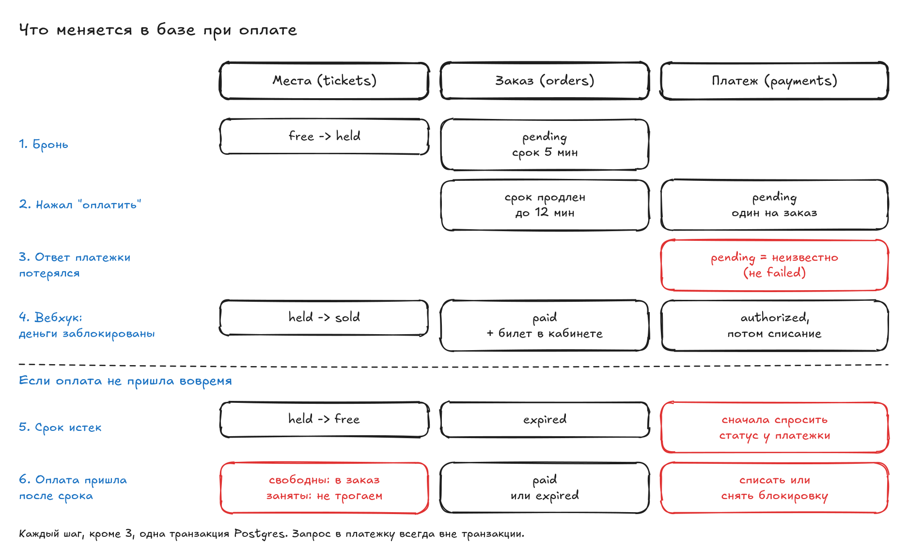
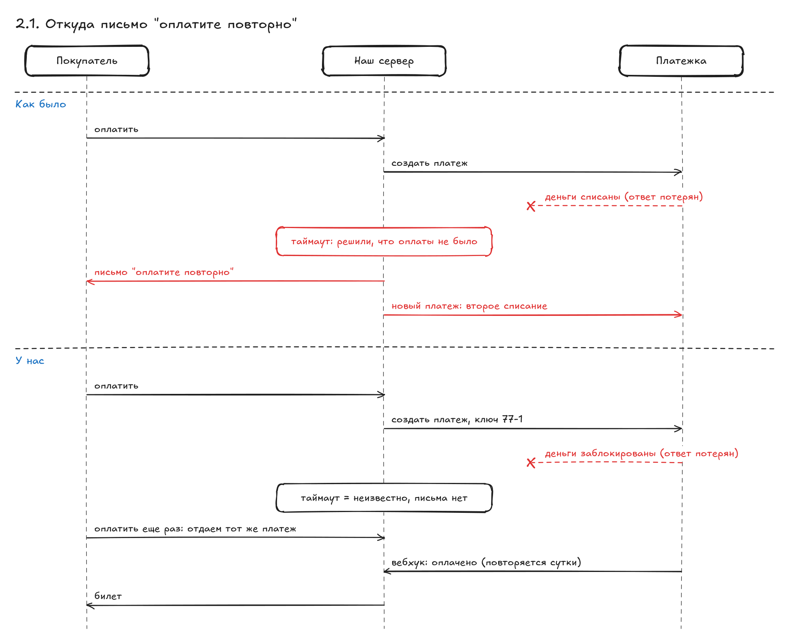
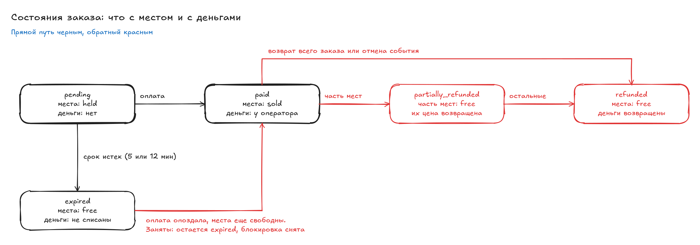

# Работа 2. Путь записи: не продать одно место дважды

**Вопрос работы.** Как удержать "одно место - один владелец", когда параллельно платят двое, деньги двигает внешняя платежка, а сеть теряет сообщения?

**Ответ коротко.**
- Правду о деньгах знает платежка, о местах - наш Postgres. Таймаут означает "неизвестно", а не "не оплачено".
- У заказа один живой платеж, поэтому второго списания не бывает.
- Деньги сначала блокируются, а списываются, только если место еще наше.
- Деньги лежат у оператора до концерта, поэтому возврат всегда делает один владелец.

## 1. Допущения

Д1-Д13 из работы 1. Новые (оценки, без замеров):

- Д14. Оплата длится 1-3 мин вместе с 3-DS.
- Д15. В пик теряется или опаздывает 1 % ответов платежки.
- Д16. 0,5 % оплат подтверждаются после конца брони.
- Д17. Средний билет 15 000 руб.
- Д18. Платежка принимает 100 возвратов/с и 100 запросов статуса/с.
- Д19. Рассылка отправляет 500 писем/с.

## 2. Расчеты

- Р31. Потерянных ответов: 64 000 заказов (Р2) * 1 % (Д15) = **640**. Каждый может стать двойным списанием.
- Р32. Опрос вместо вебхука: 300 оплат/с (Д5) * 120 с (Д14) = 36 000 платежей в процессе, опрос раз в 5 с = **7 200 запросов/с** при лимите 100 (Д18).
- Р33. Длина продаж. Каждый круг возвращает в продажу 25 % мест (Д3). Пока не останется 100 мест: 160 000 (Р1) * 0,25^k < 100, k = 5,3 круга. TTL 5 мин: **27 мин**, 10 мин: **53 мин**.
- Р34. Проверка статуса перед освобождением: 16 000 неоплаченных заказов (25 %, Д3) / 160 с (Р4) = **100 запросов/с**, ровно лимит (Д18).
- Р35. Поздних оплат: 64 000 (Р2) * 0,75 (Д3) * 0,5 % (Д16) = **240**.
- Р36. Все письма: 64 000 (Р2) / 500 (Д19) = **128 с**. 8 часов в кейсе - это не нехватка мощности, а отсутствие алерта.
- Р37. Денег у оператора до концерта: 160 000 (Р1) * 15 000 (Д17) = **2,4 млрд руб.**
- Р38. Сверка за час: 64 000 платежей (Р2) / 100 на страницу = **640 запросов**.
- Р39. Отмена события: 64 000 возвратов (Р2) / 100/с (Д18) = **11 мин**.

## 3. Ответы на вопросы



### 2.1. Письмо "оплатите повторно"



**Где система решила, что оплаты не было:** на таймауте. Ответ платежки потерялся, сервер записал отказ. Повторная оплата создала второй платеж.

**Что это исключает:**
1. Таймаут оставляет платеж в `pending`. Письма нет, на экране "оплата обрабатывается".
2. У заказа один живой платеж. Повторное нажатие отдает его же:

```sql
CREATE UNIQUE INDEX ON payments (order_id) WHERE status <> 'canceled';
```

3. В платежку уходит ключ идемпотентности заказа. На повтор с тем же ключом она вернет первый платеж ([ЮKassa](https://yookassa.ru/developers/using-api/interaction-format), [Stripe](https://docs.stripe.com/api/idempotent_requests)).
4. Результат приносит вебхук. Платежка повторяет его сутки, пока мы не ответим 200 ([ЮKassa](https://yookassa.ru/developers/using-api/webhooks)). Повторы отсекает `UNIQUE (psp_event_id)`.

### 2.2. Бронь аннулирована, деньги списаны

**(а) TTL.** 5 мин, чтобы начать оплату. Когда платеж создан, одно продление до 12 мин. Бросившие освобождают места через 5 мин, продажи идут 27 мин вместо 53 (Р33).

**(б) Как узнаем, что деньги списаны.** Из вебхука. Перед освобождением мест сами спрашиваем статус у платежки (Р34). Раз в час сверка (2.4).

**(в) Что с местом.** Деньги сначала только блокируются ([двухстадийная оплата](https://yookassa.ru/developers/payment-acceptance/getting-started/payment-process)), поэтому при опоздании их можно не списывать:

| Случай | Что делаем |
|---|---|
| места еще свободны | возвращаем в заказ одной транзакцией, списываем деньги |
| заняты все или часть | снимаем блокировку, деньги не списаны. Письмо и бронь без очереди на 10 мин |
| способ без блокировки (СБП) | автоматический возврат и та же бронь без очереди |

Чужое место не отбираем: второй покупатель ничего не нарушил. Другое место без согласия не подставляем. Таких случаев ~240 (Р35).

### 2.3. Билет через восемь часов

Билет создается в той же транзакции, что и статус `paid`, и сразу виден в кабинете. Письмо уходит отдельно через outbox.

- **SLO:** билет в кабинете за 30 с, письмо за 2 мин, оба для 99 % заказов.
- **Метрика:** возраст самого старого неотправленного письма. Алерт > 5 мин.

| Что отстает | Что делаем | Почему |
|---|---|---|
| письма | копим, на экране "билет в кабинете", продажи идут | билет уже есть, хвост уходит за 2 мин (Р36) |
| подтверждения оплат | пауза впуска (работа 1, п. 20) | иначе резервы истекают при заблокированных деньгах |

### 2.4. Где деньги

**Источник правды:** о платеже и возврате - платежка, о выплатах - банк. Наша БД хранит копию: журнал `money_movements`, строки только добавляются.

**Чтобы спора не было:** деньги лежат у оператора до концерта + 3 дня. Возврат списывается с баланса продавца ([Stripe](https://docs.stripe.com/refunds)): в кейсе деньги ушли организатору, и возвращать стало не с чего.

**Сверка** раз в час по списку платежей (Р38) и раз в сутки по реестру:

| Расхождение | Действие |
|---|---|
| деньги есть, оплаченного заказа нет | места свободны: вернуть в заказ. Иначе возврат |
| заказ оплачен, денег нет | билет заблокировать, ручной разбор |

**Отчет** по почте, телефону или номеру заказа, один запрос:

```text
Заказ 77, 2 билета, 30 000 руб.
12.08 12:01  списано (pay_abc)
13.08        на счете оператора
выплата организатору: не было
возврат: нет
```

### 2.5. Обратный путь



| Возврат | Кто начинает | Место | Деньги | Время |
|---|---|---|---|---|
| покупателя | покупатель в кабинете | снова в продаже | по [закону](https://www.consultant.ru/document/cons_doc_LAW_1870/): за 10+ дней 100 %, 5-10 дней 50 %, 3-5 дней 30 % | запрос в платежку за 1 мин, на карту до 10 рабочих дней |
| организатора | организатор через поддержку | снова в продаже или снято | 100 % | так же |
| частичный | покупатель, часть мест. Ложа только целиком | эти места в продаже | цена этих мест | так же |
| отмена события | организатор | продажи закрыты | 100 % всем автоматически | 11 мин на отправку (Р39) |

**Продажа только с работающим возвратом.** Раз в 5 мин пробная оплата 1 руб. и возврат. Не проходит 15 мин: продажи события на паузе.

## 4. Решения

| № | Вопрос | Сравнивали | Выбор | Почему | Чем платим |
|---|---|---|---|---|---|
| 1 | Как узнаем результат | ответ / вебхук / опрос | вебхук | повторяется сам, опрос не влезает в лимит (Р32) | ждем, если мы перегружены |
| 2 | Таймаут | отказ / неизвестно | неизвестно | иначе до 640 двойных списаний (Р31) | человек ждет |
| 3 | Повторная оплата | новый платеж / один живой | один живой | повтор отдает тот же платеж | сменить карту можно только в той же форме |
| 4 | Стадии оплаты | одна / блокировка + списание | две | опоздавшая оплата не списывает деньги | второй запрос на заказ |
| 5 | TTL | 5 / 10 / 15 мин | 5 + продление до 12 | продажи 27 мин вместо 53 (Р33) | кто платит дольше 12 мин, не успевает |
| 6 | Поздняя оплата | ручной разбор / замена места / правило | правило из 2.2(в) | решено заранее, а не в колл-центре | ~240 человек без билета (Р35) |
| 7 | Выдача | вместе с письмом / в транзакции оплаты | в транзакции | билет есть сразу | - |
| 8 | Отставание | копить / стоп продаж | по тому, что отстает | письма инварианты не ломают | минуты без впуска |
| 9 | Где деньги | у организатора / у нас / частями | у нас до концерта | возврат всегда проходит | 2,4 млрд на счету (Р37), организатор ждет |
| 10 | Сверка | раз в сутки / раз в час | раз в час | находим за час, 640 запросов (Р38) | ложные расхождения по платежам в пути |
| 11 | Продажа без возврата | разрешить / пауза | пауза | не копим долги, которые не вернуть | минуты без продаж |

## 5. Инварианты

| | Чем обеспечивается | Как обнаруживается | Как чинится |
|---|---|---|---|
| И1. Место продано один раз | `UPDATE ... WHERE status = 'free'`, поздняя оплата чужое место не трогает | запрос раз в 5 мин: проданные места без одной активной позиции | второму возврат и бронь без очереди |
| И2. Билетов столько, сколько в заказе | билеты в транзакции оплаты | тот же запрос | выпустить билеты или вернуть деньги |
| И3. Резерв не дольше TTL | `expires_at`, таймер раз в секунду, продление одно | резервы старше срока + 30 с, алерт > 0 | второй экземпляр таймера |
| И4. Денег столько, сколько билетов | один живой платеж, списание только за свое место | сверка раз в час | действия из таблицы сверки |

## 6. Отказы

| Компонент | Что происходит |
|---|---|
| Платежка | платежи остаются `pending`, впуск на паузе, резервы истекают, поздние оплаты по 2.2(в) |
| Вебхуки | платежка повторяет сутки, статусы добираем списком платежей |
| Таймер TTL | алерт по И3, второй экземпляр |
| Рассылка | письма копятся, билет в кабинете |
| Возвраты | продажи события на паузе |

Исходники схем: [01](diagrams/01-payment-db-path.excalidraw), [02](diagrams/02-double-payment.excalidraw), [03](diagrams/03-states.excalidraw).
